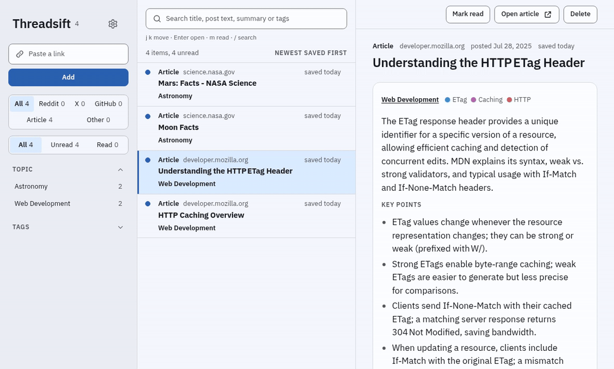
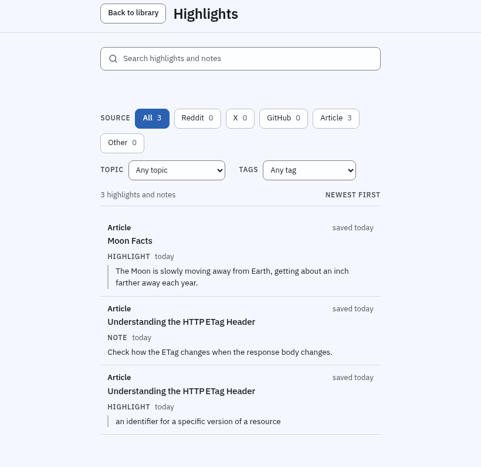
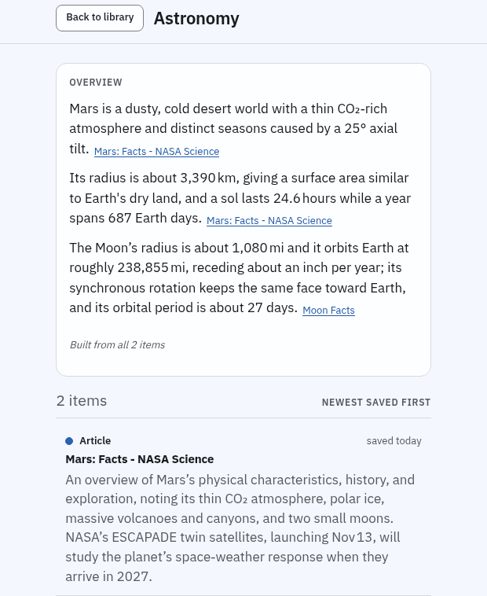
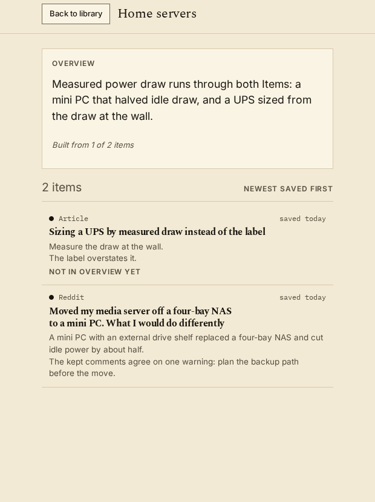
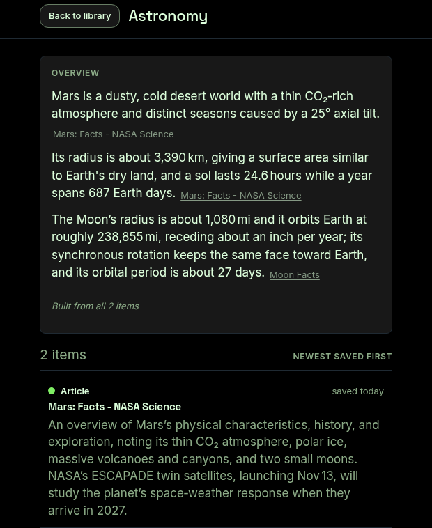

# Threadsift

Threadsift is a self-hosted reading library for saved links. Paste a link to a Reddit post or comment, an X post, a GitHub repository, or an article. With a Provider set up, the agent turns the fetched text into a Digest with a Topic, Tags, a two-line Summary, and Key points. For threads, the agent picks the comments that add something. Search and filter your Items in the library and open one in the Reader.


[](https://deploy.workers.cloudflare.com/?url=https://github.com/kyanitehq/threadsift/tree/release) [](https://cloudflare.com)

The Cloudflare route needs the [Workers Paid plan](https://developers.cloudflare.com/workers/platform/pricing/).

v1 is not released, so do not use Threadsift for real yet.

## From a Paste to a Digest



The recording skips part of the wait for the Digest. The recording and the screenshot at the top use a library of public links; the screenshots further down show made-up Items.

## Keep Highlights and Notes

Select a passage of the post text or of a comment in the Reader to keep it as a Highlight. You can also write a Note on the Item. The Highlights page gathers both and links back to the Reader.



## Let the agent keep a wiki of the library

As Items arrive, the agent writes an overview for each Topic page and picks up to five Related Items for each new Item. The Index lists the Topics and the Log records changes. Read how they fit together in the [library wiki guide](docs/wiki.md). The agent checks the library each week and may suggest changes such as merging two Tags. You choose which [Proposals](docs/proposals.md) to accept.

The screenshots show the same Topic page in three Styles: Library, Monocle, and Modal.

| Library · Light | Monocle · Sepia | Modal · Dark |
| --- | --- | --- |
|  |  |  |

## Save from wherever you are

- Paste a link into the box at the top of the library. Pasting a link you already saved refreshes that Item.
- Import a pasted or uploaded list of links at `/import`.
- Save a Reddit thread or a web page from your own browser tab with the Extension. For a Reddit thread, it reads the post and its comments through your signed-in tab.
- Send links from a script with the HTTP API and an agent token you create in Settings. `/api/openapi.json` on your Instance describes the REST routes.
- Let an agent search, read and add Items over MCP at `/mcp`, with its own agent token.
- Hand X links to Grok Bot, which reads the post, its replies, the posts it quotes and its photos, and saves them back. The [Threadsift bot guide](bot/README.md) says how to install the bot.

## Bring your own AI

Pick a Provider in Settings to run the agent. Both install targets support Anthropic, OpenAI, xAI, OpenRouter, an OpenAI-compatible address, or Grok Bot. The container also supports Claude Code and Codex signed in on your server. On Cloudflare you can use Workers AI, and an OpenAI-compatible address must use public HTTPS. See [how to set up a Provider](docs/guides/providers.md).

## Install Threadsift

| Container | Cloudflare |
| --- | --- |
| A machine that can run Podman or Docker, a persistent data volume, and a secret key. The commands below use Podman, `openssl`, and Bash or Zsh. | A Cloudflare account on Workers Paid with R2 turned on. For the button, use a GitHub account. For the CLI, use Node 26 or later, pnpm, and `openssl`, and sign in with Wrangler. |
| [Start the container](README.md#try-it-on-your-machine) | [Deploy with the button](README.md#deploy-on-cloudflare) or [deploy with the CLI](docs/guides/self-hosting.md#deploy-on-cloudflare-with-the-cli) |

### Deploy on Cloudflare

Use a GitHub account, `openssl`, and a Cloudflare account on the Workers Paid plan with R2 turned on.

1. Open [Deploy to Cloudflare](https://deploy.workers.cloudflare.com/?url=https://github.com/kyanitehq/threadsift/tree/release). Select **Create private Git repository**.
2. Run `openssl rand -hex 32` and paste the result into `THREADSIFT_SECRET_KEY`. Keep a private backup of the key for the lifetime of the Instance.
3. Run `openssl rand -hex 16` and paste the result into `SETUP_CODE`.
4. Choose **Deploy**. When the build finishes, open the Worker URL. Enter the code on the setup page and choose an owner password.

See the guide for the [full deploy steps](docs/guides/self-hosting.md#deploy-with-the-cloudflare-button), [update setup](docs/guides/self-hosting.md#update-a-cloudflare-copy), and [expired GitHub authorization fix](docs/guides/self-hosting.md#fix-an-expired-github-authorization).

### Try it on your machine

Install [Podman](https://podman.io/docs/installation). On macOS and Windows, start a Podman machine first.

1. Create the secret key. The command stops without changing a file that already exists.

   ```sh
   (set -Ceu; umask 077; key=$(openssl rand -hex 32); printf 'THREADSIFT_SECRET_KEY=%s\n' "$key" > "$HOME/threadsift.env")
   ```

   Back up `~/threadsift.env`. The app encrypts the keys you save in Settings with it, and [Keep the secret key](docs/guides/self-hosting.md#keep-the-secret-key) says what happens when it is lost.

2. Start the Instance:

   ```sh
   podman run --detach --name threadsift --pull=newer --publish 127.0.0.1:8080:8080 --volume threadsift-data:/data --env-file "$HOME/threadsift.env" ghcr.io/kyanitehq/threadsift:main
   ```

3. Read the setup code:

   ```sh
   podman logs threadsift
   ```

   Until you choose a password, every start logs a new `Setup code: <code>` line, and only the newest code works. If the line is not there yet, run the command again after a few seconds.

4. Open http://127.0.0.1:8080, enter the code and choose a password.
5. Open Settings and choose a Provider. Follow the [Provider setup guide](docs/guides/providers.md) if your choice needs an API key, Claude Code or Codex on the container, or Grok Bot. Press **Save**, then press **Verify**. Verify writes one small real Digest and adds no Item.
6. Paste your first link.

The app answers on this machine only, over plain HTTP. To reach it from other devices, read [Run Threadsift on your own server](docs/guides/self-hosting.md).

## Status

The [architecture status table](docs/architecture.md) lists the parts still in development.

## Find your way around

- [The v1 spec](docs/spec.md): what v1 does today.
- [The architecture](docs/architecture.md): what it is built with and where each part runs.
- [The glossary](GLOSSARY.md): the words the project uses, such as Item, Digest and Provider.
- [The guides](docs/guides/): the guides for running and setting up an Instance.
- [The design folder](design/) and [the design docs](docs/design/): the prototype, the design system, the design prompts and the Style list.

## License

Copyright (C) 2026 Kyanite Labs.

Threadsift is licensed under the GNU Affero General Public License, version 3 only (AGPL-3.0-only). See the [license text](LICENSE). Outside contributors sign the [Threadsift contributor licence agreement](CLA.md) using the instructions in their pull request.
