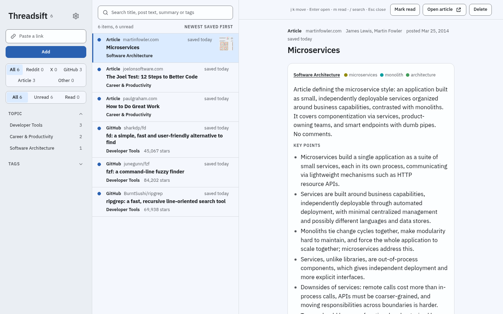

# Threadsift

Threadsift is a reading library for the links you save and never get back to. Paste a link to a Reddit post or comment, a GitHub repo or an article. Threadsift fetches it, and an agent keeps only the comments that add something, then writes a Topic, Tags, a two-line Summary and Key points. Everything you saved reads, searches and filters on one page, and you run it on your own machine.



v1 is not released, so do not use Threadsift for real yet.

## Read the useful part of a thread

The agent keeps a comment only when it adds a fact, a fix, a working link or command, first-hand experience or a real counterargument, and it leaves out agreement, jokes and repeats. The Reader shows the post, the Summary and Key points, and the Kept comments in their tree. Where the agent dropped a parent comment, one short line stands in for it, so the reply under it still makes sense. Your Highlights and your Note on the Item sit in the same view.

## Let the agent keep a wiki of the library

As Items arrive, the agent writes and updates these:

- A Topic page for each Topic, with an overview the agent writes from that Topic's Items.
- The Index, which lists every Topic with its Item count and overview line.
- Related Items: up to 5 other Items the agent links to each new one, each with a one-line reason.
- The Log, which lists the changes the agent committed to the library, newest first.

Once a week the agent also looks for problems in the library, such as two Tags that mean the same thing, a Highlight whose text a refresh removed, or two Items of one Topic whose Summaries disagree. It lists each one as a Proposal, and nothing changes until you accept it. When you accept a disagreement, the Topic page lists the two Items as a Known disagreement.

## Save from wherever you are

- Paste a link into the box at the top of the library. Pasting a link you already saved refreshes that Item.
- Import a pasted or uploaded list of links at `/import`.
- Save a Reddit thread or a web page from your own browser tab with the Extension. For a Reddit thread, it reads the post and its comments through your signed-in tab.
- Send links from a script with the HTTP API and an agent token you create in Settings. `/api/openapi.json` on your Instance describes the REST routes.
- Let an agent search, read and add Items over MCP at `/mcp`, with its own agent token.
- Hand X links to Grok Bot, which reads the post and its replies and saves them back. [bot/README.md](bot/README.md) says how to install the bot.

## Bring your own AI

Threadsift has no AI of its own. In Settings you pick one Provider, and the agent uses it for every Digest (its output for one Item). On the container you can choose an API key for Anthropic, OpenAI, xAI, OpenRouter or any OpenAI-compatible address. You can also choose Claude Code or Codex signed in on your server, which runs the Digests on your Claude or ChatGPT plan, or Grok Bot. [Set up a Provider](docs/guides/providers.md) covers the last three.

## Try it on your machine

You need [Podman](https://podman.io/docs/installation), `openssl`, and bash or zsh. On macOS and Windows, start a Podman machine first.

1. Create the secret key. The command stops without changing a file that already exists.

   ```sh
   (set -Ceu; umask 077; key=$(openssl rand -hex 32); printf 'THREADSIFT_SECRET_KEY=%s\n' "$key" > "$HOME/threadsift.env")
   ```

   Back up `~/threadsift.env`. The app encrypts the keys you save in Settings with it, and [Keep the secret key](docs/guides/self-hosting.md#keep-the-secret-key) says what happens when it is lost.

2. Start the Instance:

   ```sh
   podman run --detach --name threadsift --pull=newer --publish 127.0.0.1:8080:8080 --volume threadsift-data:/data --env-file "$HOME/threadsift.env" ghcr.io/kyanitehq/threadsift:main
   ```

3. Read the setup code:

   ```sh
   podman logs threadsift
   ```

   Until you choose a password, every start logs a new `Setup code: <code>` line, and only the newest code works. If the line is not there yet, run the command again after a few seconds.

4. Open http://127.0.0.1:8080, enter the code and choose a password.
5. Open Settings and choose a Provider. Have an API key from one of the vendors above ready, or install Claude Code or Codex on the container as [Set up a Provider](docs/guides/providers.md) shows. Press **Save**, then press **Verify**. Verify writes one small real Digest and adds no Item.
6. Paste your first link.

The app answers on this machine only, over plain HTTP. To reach it from other devices or go back to an older build, read [Run Threadsift on your own server](docs/guides/self-hosting.md).

## Status

Threadsift is a working app that is still being built. The status table at the top of [docs/architecture.md](docs/architecture.md) says what is built and what is not. Export and restore are among the parts that are not built, which is why v1 is not ready for a library you want to keep. The container image is the install target you can run today. A Cloudflare Worker runs the same app, and its deploy button is not built yet.

## Find your way around

- [docs/spec.md](docs/spec.md): what v1 does, and the decisions behind it.
- [docs/architecture.md](docs/architecture.md): what it is built with and where each part runs.
- [GLOSSARY.md](GLOSSARY.md): the words the project uses, such as Item, Digest and Provider.
- [docs/guides/](docs/guides/): how to run the container, set up a Provider and add a GitHub token.
- [design/prototype/](design/prototype/): the clickable prototype of the first screens. Its README says how to open it.
- [design/system/](design/system/): the design tokens, component styles and settings table.
- [docs/design/](docs/design/): the design prompts, the final design reviews and the Style list.

## License

Copyright (C) 2026 Kyanite Labs.

Threadsift is licensed under the GNU Affero General Public License, version 3 only (AGPL-3.0-only). See [LICENSE](LICENSE). Outside contributions need a signed contributor licence agreement, which the repo adds before the first one.
