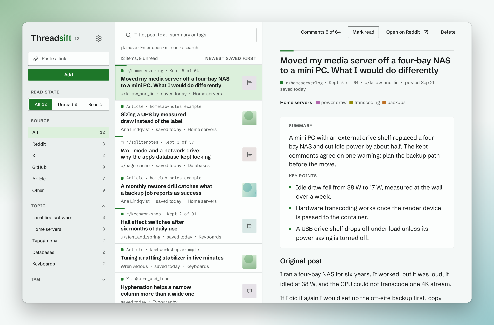
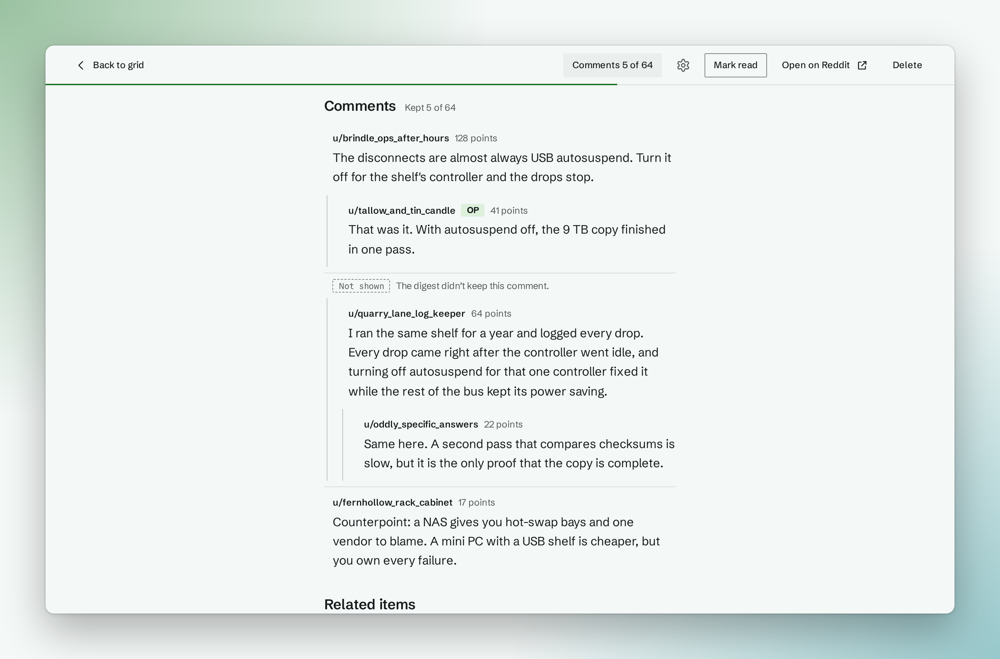
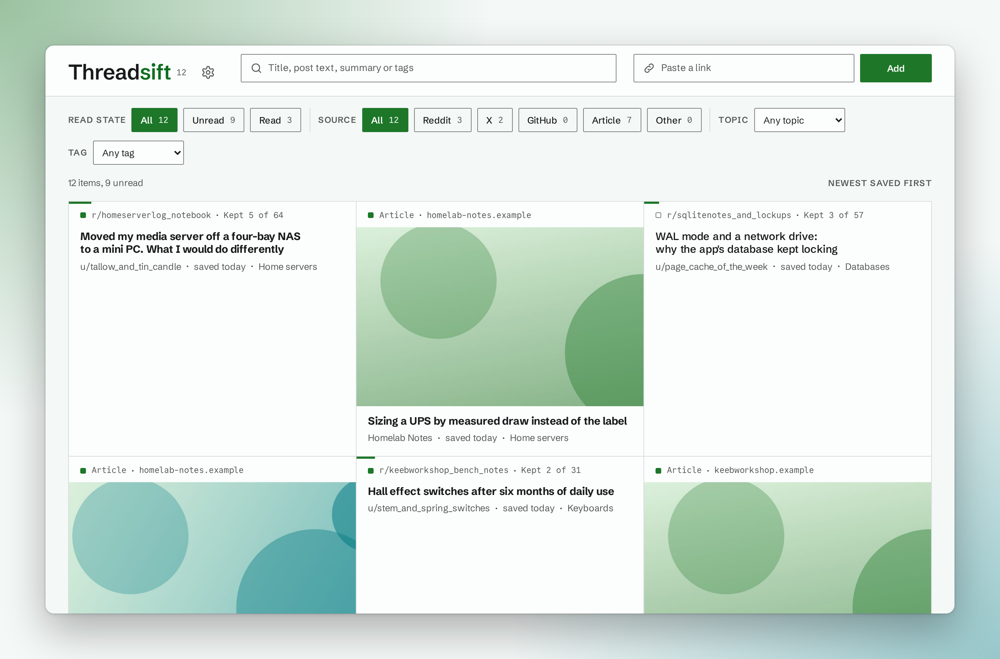
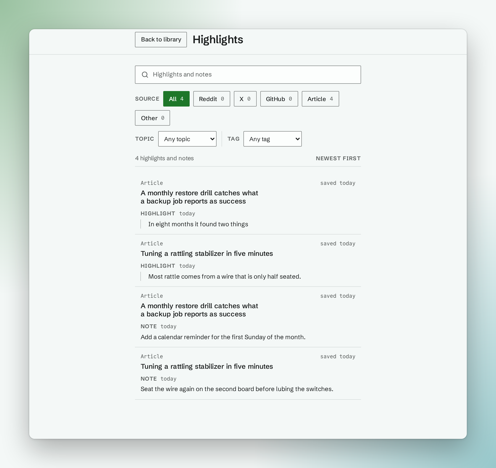
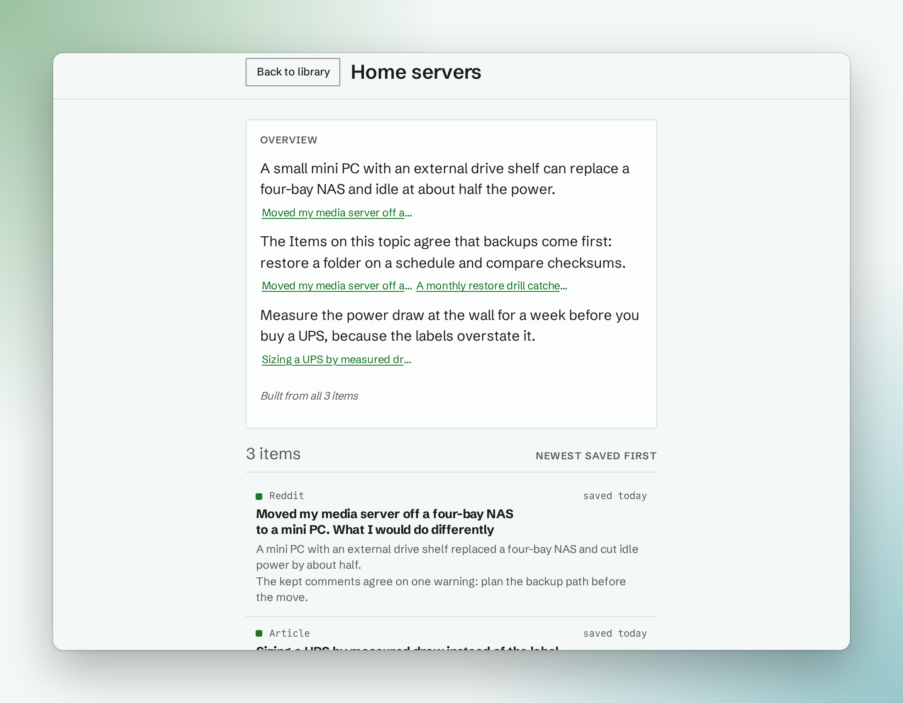
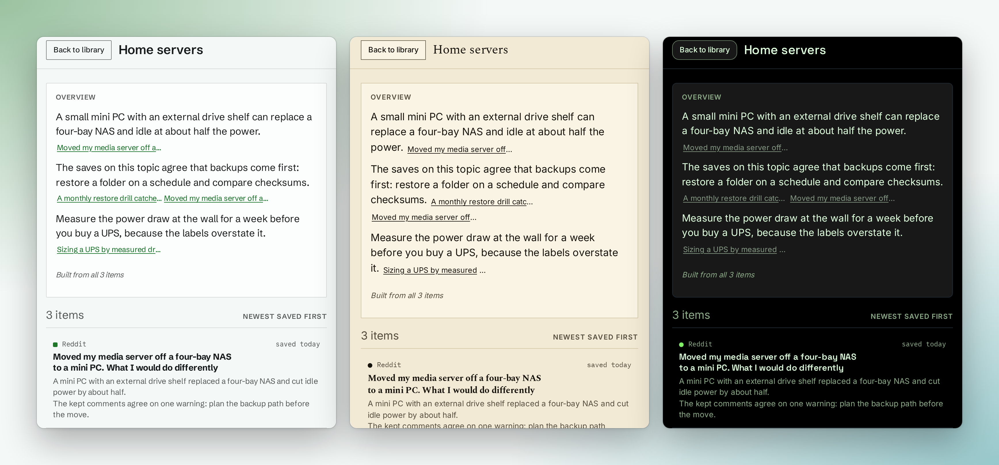

# Threadsift

Threadsift is a reading library you host yourself. Paste a link to something you saved, and an agent keeps the useful parts and grows a small wiki of your library. You read, search and filter everything on one page.

v1 is not released, so do not use Threadsift for real yet.

[](https://deploy.workers.cloudflare.com/?url=https://github.com/kyanitehq/threadsift/tree/release) or [run the container on your machine](README.md#try-it-on-your-machine). The Cloudflare option needs the [Workers Paid plan](https://developers.cloudflare.com/workers/platform/pricing/).

<picture>
  <source media="(prefers-color-scheme: dark)" srcset="docs/assets/library-dark.webp">
  
</picture>

## What it does

### Read a thread by its useful part

An agent writes a Digest for each Item: a clean title, a Topic, up to 3 Tags, a two-line Summary and Key points. For a Reddit or X thread, the agent also keeps only the comments that add something. A Kept comment adds a fact, a fix, a working link or command, first-hand experience or a real counterargument. Once a thread has a Digest, the Reader shows the Kept comments, and the Kept strip reads like `Kept 5 of 64`.

<picture>
  <source media="(prefers-color-scheme: dark)" srcset="docs/assets/reader-dark.webp">
  
</picture>

### Browse as a List or a Grid

Search covers the title, the post text, the Kept comments, the Summary, the Tags, your Highlights and your Notes. Filter by Read state, Source, Topic and Tag. Choose the List layout for three panes, or the Grid layout for cards. In Grid, cards open as a full page or as a sheet.

<picture>
  <source media="(prefers-color-scheme: dark)" srcset="docs/assets/grid-dark.webp">
  
</picture>

### Keep what matters

In the Reader, select a passage from the post text or a comment to keep it as a Highlight. Write one Note on any Item. The Highlights page lists every Highlight and Note, newest first, and each one links back to its place in the Reader.

<picture>
  <source media="(prefers-color-scheme: dark)" srcset="docs/assets/highlights-dark.webp">
  
</picture>

### Let the agent keep a wiki of the library

As Items arrive, the agent writes an overview for each Topic page and picks up to five Related Items for each new Item. The Index lists the Topics, and the Log records each change. Read how these parts fit together in the [library wiki guide](docs/wiki.md). Each week, the agent checks the library and may propose changes, such as merging two Tags. You choose which of those [Proposals](docs/proposals.md) to accept.

<picture>
  <source media="(prefers-color-scheme: dark)" srcset="docs/assets/topic-dark.webp">
  
</picture>

### Choose a look

Settings has 11 [Styles](docs/design/styles.md) and four Themes: Light, Dark, Sepia and System, which follows your device. The screenshot shows the same Topic page in three Styles.

| Library · Light | Monocle · Sepia | Modal · Dark |
| --- | --- | --- |
| The default Style | A paper look with hairline rules | A developer look on near-black |



## Save from wherever you are

- Paste a link into the box at the top of the library. Pasting a link you already saved refreshes that Item.
- Import a pasted or uploaded list of links at `/import`.
- Share a link from your phone. You can install Threadsift as a web app, and the Android Share menu sends the link into the same Paste.
- Save a Reddit thread or a web page from your own browser tab with the Extension. The Extension works in desktop Chrome and Firefox. For a Reddit thread, it reads the post and its comments through your signed-in tab.
- Send links from a script with the HTTP API and an agent token you create in Settings. `/api/openapi.json` on your Instance describes the REST routes.
- Let an agent search, read and add Items over MCP at `/mcp`. The agent uses its own agent token.
- Send X links to Grok Bot. Grok Bot reads each post, its replies, its photos and the posts it quotes, and saves them back to Threadsift. The [Threadsift bot guide](bot/README.md) says how to install the bot.

## Bring your own AI

Pick a Provider in Settings to run the agent. Both install targets support Anthropic, OpenAI, xAI, OpenRouter, an OpenAI-compatible address, and Grok Bot. The container also supports Claude Code and Codex signed in on your server. On Cloudflare, Threadsift also supports Workers AI, and an OpenAI-compatible address must use public HTTPS. See [how to set up a Provider](docs/guides/providers.md).

## Install Threadsift

| Container | Cloudflare |
| --- | --- |
| A machine that can run Podman or Docker, a persistent data volume, and a secret key. The commands below use Podman, `openssl`, and Bash or Zsh. | A Cloudflare account on Workers Paid with R2 turned on. For the button, use a GitHub account. For the CLI, use Node 26 or later, pnpm, and `openssl`, and sign in with Wrangler. |
| [Start the container](README.md#try-it-on-your-machine) | [Deploy with the button](README.md#deploy-on-cloudflare) or [deploy with the CLI](docs/guides/self-hosting.md#deploy-on-cloudflare-with-the-cli) |

### Deploy on Cloudflare

You need a GitHub account, `openssl`, and a Cloudflare account on the Workers Paid plan with R2 turned on.

1. Open [Deploy to Cloudflare](https://deploy.workers.cloudflare.com/?url=https://github.com/kyanitehq/threadsift/tree/release) and select your GitHub account.
2. Choose a project name and names for the D1 database, R2 bucket and Queue. Use names your account does not already have.
3. Select **Create private Git repository**.
4. Run `openssl rand -hex 32` and paste the result into `THREADSIFT_SECRET_KEY`. Keep a private backup of the key for the lifetime of the Instance.
5. Run `openssl rand -hex 16` and paste the result into `SETUP_CODE`.
6. Keep the build command `pnpm run build` and the deploy command `pnpm run deploy`. Select **Deploy**. When the build finishes, open the Worker URL. Enter the setup code on the setup page and choose an owner password.

See the guide for the [full deploy steps](docs/guides/self-hosting.md#deploy-with-the-cloudflare-button), [update setup](docs/guides/self-hosting.md#update-a-cloudflare-copy), and [expired GitHub authorization fix](docs/guides/self-hosting.md#fix-an-expired-github-authorization).

### Try it on your machine

Install [Podman](https://podman.io/docs/installation). On macOS and Windows, start a Podman machine first.

1. Create the secret key. The command stops without changing a file that already exists.

   ```sh
   (set -Ceu; umask 077; key=$(openssl rand -hex 32); printf 'THREADSIFT_SECRET_KEY=%s\n' "$key" > "$HOME/threadsift.env")
   ```

   Back up `~/threadsift.env`. Threadsift uses the key in this file to encrypt the keys you save in Settings. [Keep the secret key](docs/guides/self-hosting.md#keep-the-secret-key) says what happens if you lose it.

2. Start the Instance:

   ```sh
   podman run --detach --name threadsift --pull=newer --publish 127.0.0.1:8080:8080 --volume threadsift-data:/data --env-file "$HOME/threadsift.env" ghcr.io/kyanitehq/threadsift:main
   ```

3. Read the setup code:

   ```sh
   podman logs threadsift
   ```

   Until you choose a password, the Instance logs a new `Setup code: <code>` line each time it starts. Only the newest code works. If the line is not there yet, run the command again after a few seconds.

4. Open http://127.0.0.1:8080 in your browser. Enter the setup code and choose a password.
5. Open Settings and choose a Provider. If it needs an API key, Claude Code or Codex on the container, or Grok Bot, follow the [Provider setup guide](docs/guides/providers.md). Press **Save**, then press **Verify**. Verify writes one small real Digest without adding an Item.
6. Paste your first link.

The Instance responds only on this machine, over plain HTTP. To reach it from other devices, read [Run Threadsift on your own server](docs/guides/self-hosting.md).

## Status

The [architecture status table](docs/architecture.md) lists the parts still in development.

## Find your way around

- [The v1 spec](docs/spec.md): what v1 does today.
- [The architecture](docs/architecture.md): what it is built with and where each part runs.
- [The glossary](GLOSSARY.md): the words the project uses, such as Item, Digest and Provider.
- [The guides](docs/guides/): the guides for running and setting up an Instance.
- [The design folder](design/) and [the design docs](docs/design/): the prototype, the design system, the design prompts and the Style list.

## License

Copyright (C) 2026 Kyanite Labs.

Threadsift is licensed under the GNU Affero General Public License, version 3 only (AGPL-3.0-only). See the [license text](LICENSE). Outside contributors sign the [Threadsift contributor licence agreement](CLA.md) using the instructions in their pull request.
